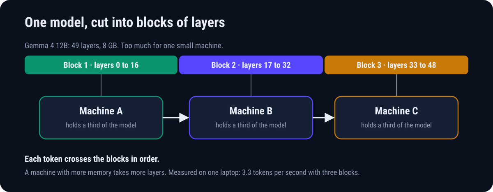

# Moteur Tor6IA : un modèle, plusieurs machines

**Fais tourner un modèle d'IA trop gros pour ta machine, en le partageant avec d'autres machines.** Le moteur découpe un modèle en blocs de couches. Chaque machine porte les blocs que sa mémoire permet, et chaque token les traverse dans l'ordre.

C'est le moteur de [Tor6IA](https://github.com/tomDeprez/Tor6IA), le réseau pair à pair pour les modèles ouverts. [English](README.md)

<p align="center"></p>

## Essayer en une commande

Il te faut un fichier de modèle : un `.gguf`, ou n'importe quel modèle déjà téléchargé par [Ollama](https://ollama.com).

**Windows** : télécharge [tor6ia-engine-windows-amd64.exe](https://github.com/tomDeprez/Tor6IA-engine/releases/latest/download/tor6ia-engine-windows-amd64.exe), puis :

```powershell
.\tor6ia-engine-windows-amd64.exe demo --model gemma4:12b
```

**Linux et macOS** :

```sh
curl -fsSL https://raw.githubusercontent.com/tomDeprez/Tor6IA-engine/main/install.sh | sh
~/.local/bin/tor6ia-engine demo --model gemma4:12b
```

La démo lance trois serveurs de blocs sur ta machine, répartit le modèle entre eux, affiche qui porte quelles couches, et pose une question :

```
BLOCK   MACHINE           LAYERS     SHARE OF THE MODEL
1       127.0.0.1:54470   0 to 16    34 %
2       127.0.0.1:54471   17 to 32   32 %
3       127.0.0.1:54472   33 to 48   32 %

3.3 tokens per second, with every layer computed by a block server.
```

Rien d'autre à installer : le moteur télécharge le programme qui fait les calculs, [llama.cpp](https://github.com/ggml-org/llama.cpp), et vérifie son empreinte.

## Est-ce que ça tient à travers Internet ?

Mesuré, pas supposé. Gemma 4 12B, un portable sans carte graphique (Intel Core Ultra 7 265U), le modèle coupé entre deux serveurs de blocs, et un relais qui ajoute du délai réseau dans chaque sens ([proof/delayproxy](proof/delayproxy)) :

| Montage | Vitesse |
|---|---|
| Non découpé : un processus, 6 processeurs | 4,5 tokens par seconde |
| Coupé en deux, même machine | 3,3 |
| Coupé en deux, 10 ms dans chaque sens (même ville) | 2,9 |
| Coupé en deux, 25 ms dans chaque sens (même pays) | 2,5 |
| Coupé en deux, 50 ms dans chaque sens (un continent) | 1,9 |

Le découpage coûte peu, et la distance moins que prévu.

## L'utiliser sur plusieurs machines

Sur chaque machine qui prête sa mémoire :

```sh
tor6ia-engine block --listen 0.0.0.0:50052
```

Sur la machine qui tient la conversation, avec le fichier du modèle :

```sh
tor6ia-engine head --model gemma4:12b --blocks 192.168.1.20:50052,192.168.1.21:50052
```

La tête affiche les blocs, puis sert une API compatible OpenAI sur `http://127.0.0.1:8090/v1`. Une machine avec plus de mémoire libre reçoit plus de couches.

**Uniquement entre machines de confiance.** Un serveur de blocs n'a ni identification ni chiffrement : toute machine qui atteint son port peut lancer des calculs dedans. Utilise un réseau privé ou un VPN. C'est pour ça que le moteur n'est pas encore ouvert aux inconnus sur le réseau Tor6IA.

## Où on en est

Construit et testé :

- Un modèle réparti entre des serveurs de blocs, avec l'emplacement de chaque couche affiché.
- Une commande pour l'essayer. Chaque version lance la démo sur des machines Windows, Linux et macOS vierges.
- Le coût du délai réseau, mesuré.

Pas encore construit, dans l'ordre prévu :

1. **Relais.** Les machines derrière une box ne se joignent pas directement. Le coordinateur Tor6IA portera le trafic entre la tête et les blocs.
2. **Plusieurs machines par bloc.** Quand l'une part, la suivante qui porte le même bloc prend le relais. Aujourd'hui un serveur de blocs qui s'arrête coupe la réponse.
3. **Les blocs affichés dans Tor6IA.** Combien de blocs porte ta machine, combien sont couverts, et combien de machines un modèle attend encore.
4. **Paiement par bloc.** Chaque machine payée pour la part du modèle qu'elle calcule.
5. **Bac à sable.** Faire tourner des serveurs de blocs sans risque pour des inconnus, ce que le réseau public exige.

## Licence

[MIT](LICENSE)
