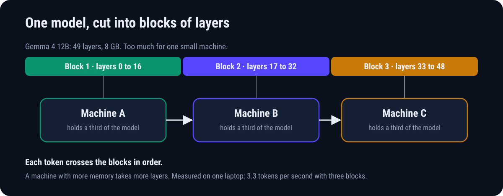

# Tor6IA engine: one model, several machines

[](https://github.com/tomDeprez/Tor6IA-engine/actions/workflows/ci.yml)
[](https://github.com/tomDeprez/Tor6IA-engine/releases/latest)
[](LICENSE)

**Run a language model that is too big for your machine, by sharing it with other machines.** The engine cuts a model into blocks of layers. Each machine holds the blocks its memory allows, and a token crosses them in order.

It is the engine behind [Tor6IA](https://github.com/tomDeprez/Tor6IA), the peer-to-peer network for open models. [Français](README.fr.md)

<p align="center"></p>

## Try it in one command

You need one model file: a `.gguf`, or any model [Ollama](https://ollama.com) already downloaded.

**Windows**: download [tor6ia-engine-windows-amd64.exe](https://github.com/tomDeprez/Tor6IA-engine/releases/latest/download/tor6ia-engine-windows-amd64.exe), then:

```powershell
.\tor6ia-engine-windows-amd64.exe demo --model gemma4:12b
```

**Linux and macOS**:

```sh
curl -fsSL https://raw.githubusercontent.com/tomDeprez/Tor6IA-engine/main/install.sh | sh
~/.local/bin/tor6ia-engine demo --model gemma4:12b
```

The demo starts three block servers on your machine, splits the model across them, shows who holds which layers, and asks one question:

```
3 block servers started. Loading gemma4:12b across them...

BLOCK   MACHINE           LAYERS     SHARE OF THE MODEL
1       127.0.0.1:54470   0 to 16    34 %
2       127.0.0.1:54471   17 to 32   32 %
3       127.0.0.1:54472   33 to 48   32 %

Question: Explain in one sentence what a peer-to-peer network is.
Answer:   A peer-to-peer (P2P) network is a decentralized computing architecture where each
          computer (node) has equal status and can both share and receive resources or data
          directly with other nodes without the need for a central server.

3.3 tokens per second, with every layer computed by a block server.
```

Nothing else to install: the engine downloads the program that does the math, [llama.cpp](https://github.com/ggml-org/llama.cpp), and checks its checksum.

## Does it hold across the Internet?

Measured, not guessed. Gemma 4 12B, a laptop with no graphics card (Intel Core Ultra 7 265U), the model split between two block servers, and a relay that adds network delay in each direction ([proof/delayproxy](proof/delayproxy)):

| Setup | Speed |
|---|---|
| Not split: one process, 6 processors | 4.5 tokens per second |
| Split in two, same machine | 3.3 |
| Split in two, 10 ms each way (same city) | 2.9 |
| Split in two, 25 ms each way (same country) | 2.5 |
| Split in two, 50 ms each way (across a continent) | 1.9 |

Splitting costs little, and distance costs less than expected: about 40 % of the speed is left to the network at 50 ms each way.

## Use it on several machines

On each machine that lends its memory:

```sh
tor6ia-engine block --listen 0.0.0.0:50052
```

On the machine that holds the conversation, with the model file:

```sh
tor6ia-engine head --model gemma4:12b --blocks 192.168.1.20:50052,192.168.1.21:50052
```

The head prints the blocks, then serves an OpenAI-compatible API on `http://127.0.0.1:8090/v1`. A machine with more free memory receives more layers. Each block server keeps the layers it received on disk, so the next start loads them locally.

**On a Mac.** The demo and block servers are tested on the processor: add `--device CPU`. On GitHub's virtual Macs the graphics card stops a block server with "unsupported op"; a real Mac's graphics card has not been tested yet.

**Only between machines you trust.** A block server has no login and no encryption: any machine that can reach its port can run computations inside it. Use a private network or a VPN. This is why the engine is not yet open to strangers on the Tor6IA network.

## Where it stands

Built and tested:

- A model split across block servers, with the placement of every layer shown.
- One command to try it. Every release runs the demo on clean Windows, Linux and macOS machines (macOS on the processor).
- The cost of network delay, measured.

Plugged into Tor6IA since its version 0.2.0: a node shares a model split across machines its owner trusts, and its interface shows the blocks.

Not built yet, in the order planned:

1. **Relay.** Home machines cannot reach each other directly. The Tor6IA coordinator will carry the traffic between head and blocks.
2. **Several machines per block.** When one leaves, the next one that holds the same block takes over. Today a block server that stops ends the answer.
3. **Blocks shown in Tor6IA.** How many blocks your machine holds, how many are covered, and how many machines a model is still waiting for.
4. **Payment per block.** Each machine paid for the share of the model it computes.
5. **Sandbox.** Run block servers safely for strangers, which the public network needs.

Known limit: when the engine itself is killed by force, the model it started keeps running and keeps its memory. Stopping it normally, or stopping the program that drives it, cleans everything.

## How it works

- **llama.cpp does the math.** It already knows how to place layers on remote machines. The engine starts it, feeds it the right machines and reads back where each layer went. One build is pinned with its checksum: what you download is what was tested.
- **No second download.** A model Ollama has is used where it is.
- **One file.** No dependency outside the Go standard library.

```sh
go test ./...
go build -o dist/tor6ia-engine .
```

| File | Role |
|---|---|
| `llama.go` | pinned llama.cpp download, model lookup |
| `run.go` | block servers, head, demo |
| `blocks.go` | reads which machine holds which layers |
| `proof/delayproxy` | the relay that adds delay, used for the measurements |

## License

[MIT](LICENSE)
